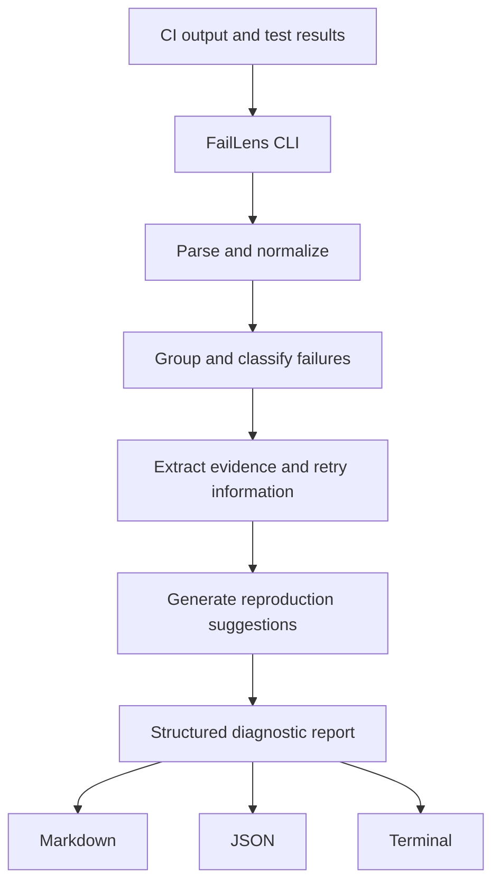

# FailLens

<div align="center">

<h1>🔎 FailLens</h1>

<h3>Stop staring at CI logs. Find the failure that matters.</h3>

<p>An open-source TypeScript CLI that turns noisy CI failures into structured, evidence-backed diagnoses and actionable reproduction commands.</p>

<p>
  <a href="https://github.com/Riyaansh-Mittal/fail-lens/actions"></a>
  <a href="https://github.com/Riyaansh-Mittal/fail-lens/blob/main/LICENSE"></a>
  <a href="https://github.com/Riyaansh-Mittal/fail-lens"></a>
  <a href="https://github.com/Riyaansh-Mittal/fail-lens/issues"></a>
  
  
</p>

<p>
  <a href="https://github.com/Riyaansh-Mittal/fail-lens">Repository</a>
  ·
  <a href="https://github.com/Riyaansh-Mittal/fail-lens/issues">Report a bug</a>
  ·
  <a href="https://github.com/Riyaansh-Mittal/fail-lens/blob/main/LICENSE">MIT License</a>
</p>

</div>

---

## Is FailLens useful for you?

FailLens is for developers and CI maintainers who need to turn a noisy failed test run into a short, inspectable starting point.

It is a good fit if you want to:

- Analyze Playwright, Vitest, JUnit, or terminal failure output locally.
- Group repeated failures and distinguish stable failures from insufficient retry evidence.
- See the evidence behind each deterministic classification.
- Generate safe, shell-quoted reproduction suggestions.
- Produce Markdown for humans or JSON for automation.
- Keep CI logs local and avoid requiring an AI API key.

It is intentionally **not** an autonomous root-cause oracle. FailLens reports what the available evidence supports and keeps uncertain conclusions explicit.

## CI failed. Now what?

A failing test suite can produce hundreds of lines of logs. The actual cause might be one assertion, a timeout, a missing dependency, or a failure that only appears on a particular retry.

Instead of manually digging through raw logs, FailLens gives you:

1. **Normalized failures** — consistent records across supported test formats.
2. **Evidence** — messages, stacks, locations, outputs, and retry results connected to the diagnosis.
3. **Deterministic diagnostics** — stable categories, grouping, and recommendations without network calls.
4. **Reproduction suggestions** — framework-aware commands you can review and run yourself.

**The goal: spend less time searching logs and more time fixing bugs.**

## What it does

- **Failure ingestion** — parse Playwright JSON, Vitest JSON, JUnit XML, and terminal output.
- **Structured diagnostics** — normalize failures into a consistent TypeScript model.
- **Evidence-backed reporting** — link diagnostic claims to retained input evidence.
- **Retry analysis** — classify repeated failures as stable, mixed outcomes as flaky only with sufficient attempts, and single retries as inconclusive.
- **Reproduction suggestions** — generate framework-aware commands with shell quoting and stable de-duplication.
- **Markdown and JSON output** — readable reports for people and structured reports for tools.
- **Privacy-aware handling** — redact common credentials and bound untrusted evidence before reporting.
- **Local-first execution** — the deterministic core works without an AI API key.

## How it works



Deterministic rules handle the core analysis. Optional AI-assisted explanations can be added separately without making an AI API key a prerequisite for the core workflow.

## Quickstart

### Requirements

- Node.js 22.23.3 (see [`.nvmrc`](.nvmrc))
- npm

### From a repository checkout

```bash
git clone https://github.com/Riyaansh-Mittal/fail-lens.git
cd fail-lens
npm ci
npm run build
```

Analyze the bundled sample:

```bash
node dist/cli.js examples/sample-failure.txt
```

Generate machine-readable JSON:

```bash
node dist/cli.js --format json examples/sample-failure.txt
```

Read from standard input and save a report:

```bash
cat failures.json | node dist/cli.js --format json --output report.json
```

The commands above use the built CLI, so they do not depend on `npx` downloading tools at runtime.

### Docker

Build the pinned Linux image:

```bash
docker build -t fail-lens .
```

Run the bundled sample:

```bash
docker run --rm fail-lens examples/sample-failure.txt
```

Analyze a local report through standard input:

```bash
cat failures.json | docker run --rm -i fail-lens --format json
```

## Usage

### Analyze a file

```bash
node dist/cli.js examples/sample-failure.txt
```

### Choose an output format

```bash
node dist/cli.js --format json examples/sample-failure.txt
```

Use JSON when another script or tool needs to consume the report. Use the default Markdown output when you want to inspect a diagnosis directly in the terminal.

### Save a report

```bash
node dist/cli.js --format markdown --output report.md examples/sample-failure.txt
```

### Display help

```bash
node dist/cli.js --help
```

Invalid options, unreadable files, and malformed inputs exit nonzero with a useful error.

## Supported inputs

| Input | Typical source | What FailLens preserves |
| --- | --- | --- |
| Terminal output | CI logs, test runner stderr | Failure lines, locations, and bounded output evidence |
| Playwright JSON | Playwright reporter | Suites, specs, retries, locations, attachments, stdout/stderr |
| Vitest JSON | Vitest/Jest-compatible reporter | Test results, ancestor suites, messages, locations, durations |
| JUnit XML | Java, Python, Jest, and other CI reporters | Test cases, failures, errors, skips, timing, and system output |

For generic JSON, FailLens accepts an object containing a `failures` array. Framework-specific reporters can provide richer top-level structures, including passed, skipped, and retried tests.

A generic failure object can include:

| Field | Purpose |
| --- | --- |
| `testName` | Identifies the failing test |
| `message` | Describes the failure |
| `stack` | Provides stack-trace evidence |
| `framework` | Identifies the testing framework |
| `kind` | Provides a failure category |
| `status` | Represents the reported outcome |
| `attempt` | Identifies the attempt or retry |
| `metadata` | Carries additional structured information |

## Understanding the output

A useful diagnostic report should help answer three questions:

1. **What failed?** Identify the affected test and its reported failure.
2. **What evidence supports the diagnosis?** Inspect the message, stack trace, locations, output, and retry information.
3. **How can I investigate it?** Use the generated reproduction suggestions as a starting point for local debugging.

Each diagnostic includes a category, confidence, deterministic rule ID, affected failure IDs, evidence IDs, suggested actions, and optional reproduction commands.

FailLens uses deterministic rules for its core classification. A classification is not a guarantee of root cause: missing logs, incomplete test results, and ambiguous failures can limit what the tool can conclude.

## Privacy and execution model

FailLens is designed around local-first diagnostics:

- **No AI API key required:** the deterministic core runs without one.
- **No automatic uploads:** input is processed locally by the CLI.
- **Evidence-driven:** diagnoses are based on available failure information.
- **Bounded evidence:** oversized untrusted content is truncated and marked.
- **Credential redaction:** common bearer tokens, API-key formats, passwords, and related values are redacted before reporting.
- **Review before sharing:** redaction is a safeguard, not a guarantee that every possible secret format will be detected.

See [`docs/privacy.md`](docs/privacy.md) for the privacy contract.

## Development

Install dependencies:

```bash
npm ci
```

Build:

```bash
npm run build
```

Type-check:

```bash
npm run typecheck
```

Run acceptance and privacy tests:

```bash
npm test
```

`npm test` is the single project test command. It builds the CLI, runs the acceptance and privacy tests, then runs the parser, diagnostics, reporting, and reproduction tests. It uses declared local dependencies rather than downloading tools through `npx` during individual tests.

## Project structure

```text
fail-lens/
├── .github/workflows/ci.yml
├── .dockerignore
├── .env.example
├── .nvmrc
├── Dockerfile
├── docs/privacy.md
├── examples/sample-failure.txt
├── src/
│   ├── cli.ts
│   ├── contracts/
│   ├── diagnose/
│   ├── ingest/
│   ├── report/
│   └── reproduce/
├── tests/
│   ├── acceptance/
│   ├── diagnose/
│   ├── fixtures/
│   ├── ingest/
│   ├── privacy/
│   ├── report/
│   └── reproduce/
├── package.json
├── package-lock.json
├── LICENSE
└── README.md
```

## Roadmap

Potential areas for future development include:

- More robust adapters for additional test-report formats
- Better grouping of related failures across jobs
- Richer retry and flaky-test evidence
- CI platform integrations and reusable GitHub Actions workflows
- Improved reproduction guidance for complex failures
- Optional AI-assisted explanations with explicit privacy controls

These are potential directions, not promises that every item is already implemented.

## Contributing

Contributions, bug reports, and suggestions are welcome.

1. Open an [issue](https://github.com/Riyaansh-Mittal/fail-lens/issues) describing the problem or proposed improvement.
2. Create a branch for your change.
3. Add or update tests for the behaviour you change.
4. Run the build, type-check, and test commands.
5. Open a pull request describing the change and its verification.

Please avoid including real credentials, private CI logs, or other sensitive information in issues and pull requests.

## License

FailLens is released under the [MIT License](LICENSE).

---

<div align="center">

**Turn CI failures into evidence you can act on.**

[Explore the code](https://github.com/Riyaansh-Mittal/fail-lens)
·
[Report an issue](https://github.com/Riyaansh-Mittal/fail-lens/issues)

</div>
